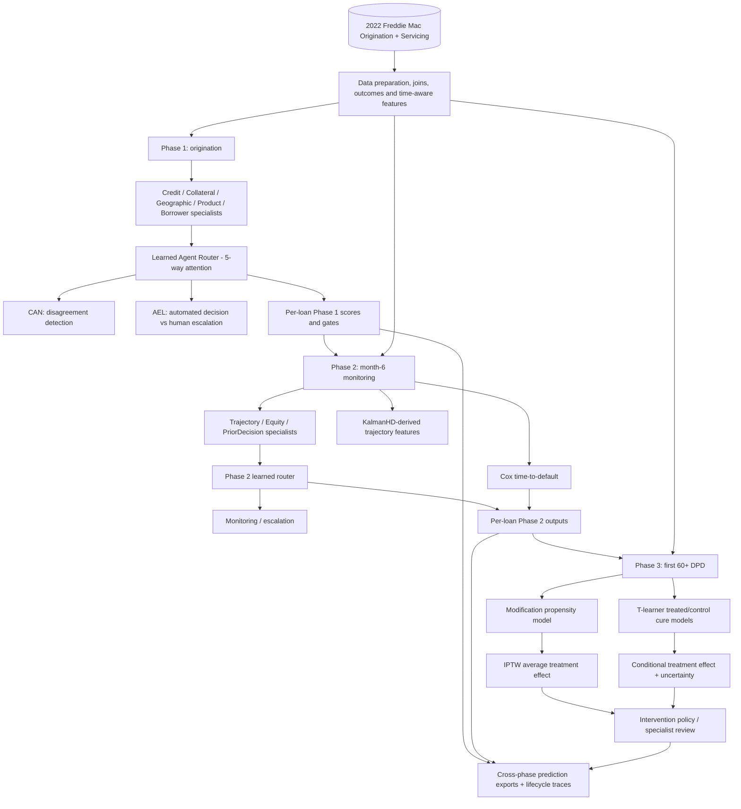

# MOLOA — Research and Engineering Case Study

> **Full name:** Multi-Agent Orchestration for Loan Origination and Aftercare  
> **Project type:** Academic research prototype, not a deployed lending decision service  
> **Data:** Freddie Mac Single-Family Loan-Level Dataset (SFLLD), 2022 sample; raw licensed files are not redistributed  
> **Methods:** Domain-specific XGBoost agents, PyTorch learned gating, conflict detection, cost-sensitive escalation, survival modelling, KalmanHD, propensity weighting and T-learner treatment-effect estimation  
> **Source of results:** [README](README.md), [full pipeline notebook](notebook/MOLOA_full_pipeline.ipynb), [benchmark CSV](results/phase1_benchmark_results.csv) and [result artifacts](results/)  
> **Interactive demonstration:** https://wenjun78.github.io/MOLOA/demo/moloa_demo.html

## 1. Executive summary

MOLOA examines whether mortgage credit decision support can be structured as **specialist models that coordinate across the loan lifecycle**, rather than one black-box classification performed only at loan origination.

It models three decision points: **Phase 1, origination (month 0); Phase 2, early monitoring (month 6); Phase 3, distress intervention (first 60+ days-past-due episode)**. It passes an origination risk signal to monitoring, then uses observed outcomes and treatment-effect modelling to study possible intervention policies on distressed loans.

**“Multi-agent” here means a coordinated collection of predictive/decision models.** These are not LLM tool-calling agents; the repo does not use LangGraph, RAG, A2A or generative AI to implement MOLOA. The primary technical areas are supervised ML, neural gating, survival analysis, causal inference and lifecycle integration.

The repository includes a full training notebook, exported benchmark data, per-loan prediction files, a browser demonstration and two CLI demonstrations. **The CLI “what-if” scorer is an approximation**, not loading and running all trained research models. The prediction-file trace reads saved model outputs and is distinct from the approximation.

## 2. Research background and problems

Three related problems motivate the architecture:

1. **Opaque, one-stage risk decisions.** A single classifier can estimate credit risk but does not explicitly show the contribution of credit, collateral, geography, product and borrower domains.
2. **Disconnected stages.** Origination models and servicing/monitoring models can be developed separately, even though the earlier risk assessment and later payment trajectory should be interpreted together.
3. **Biased intervention comparisons.** Modified loans are not selected at random. Comparing cure rates of modified and unmodified loans without accounting for selection can give a misleading picture of treatment effects.

### Research questions

- Can specialized credit-risk models be combined by **learned, input-dependent weights** while retaining useful default prediction performance?
- Can disagreement among specialists be identified independently from predicting default?
- Can the system explicitly trade the cost of an automated mistake against the cost of human review?
- Does adding early repayment behaviour and the Phase 1 output provide better monitoring information?
- For a distressed subset, can observational causal methods estimate the potential benefit of modification, and with what uncertainty?

These are research questions, not claims that an autonomous lender is ready to make consequential credit decisions.

## 3. Objectives, scope and data

### Objectives

- Design five underwriting specialist models with domain-separated feature groups.
- Train a **Learned Agent Router (LAR)** to combine their risk outputs using entropy-regularized attention.
- Build a **Conflict Arbitration Network (CAN)** to identify disagreement patterns and an **Adaptive Escalation Logic (AEL)** module for cost-sensitive human referral.
- Track the same loan into month-6 monitoring using payment trajectory, prior decision signals and survival outcomes.
- Examine modification-versus-no-modification effects for loans reaching distress using **IPTW ATE** and **T-learner CATE**.
- Compare against simple voting, ensemble and standard ML baselines, including reporting results where MOLOA is not strongest.

### Dataset and outcome definitions

The [notebook](notebook/MOLOA_full_pipeline.ipynb) constructs a one-row-per-loan master table from the 2022 Freddie Mac origination and monthly servicing records.

| Stage | Population and time | Label / objective |
|---|---|---|
| Phase 1 | Origination features only, evaluated on a 50,000-loan sample | `EVER_90DPD_24MO`: whether a loan reaches 90+ delinquency / severe default condition within 24 months |
| Phase 2 | Loans observed at month 6 (the notebook describes about 49,220) | Time until first 90+ delinquency event, censored at 24 months; updated risk |
| Phase 3 | Distressed subset (the notebook describes 2,256 loans reaching 60+ DPD) | Modification treatment and cure within six months of the first distress episode |

The README reports **1.82% Phase 1 default prevalence**, creating a strong class imbalance. The raw SFLLD files are governed by the data provider's license; follow its access and redistribution terms. Model artifacts are regenerated through the notebook rather than checked in as full trained pickles.

**Time awareness matters.** Phase 1 cannot legitimately include payment events from future months. Phase 2 uses information from the first six months; Phase 3 requires information available at or before the intervention decision. The notebook describes stage-specific feature preparation; prospective temporal-validity checks would be necessary before any real decision use.

## 4. System architecture



**Execution environment:** the main implementation is a training/evaluation [Jupyter notebook](notebook/MOLOA_full_pipeline.ipynb), not a production microservice. Saved per-phase Parquet predictions support a separate read-only demonstration.

### Phase 1 — Origination

Five XGBoost specialists are trained on distinct feature domains, as specified in notebook `B4–B8:

| Specialist | Example signals | Purpose |
|---|---|---|
| CreditAgent | Credit score, debt-to-income, interest-rate signals | Borrower credit and affordability |
| CollateralAgent | Loan-to-value, property type, occupancy | Security and collateral quality |
| GeographicAgent | Geographic fields | Localized property / market patterns |
| ProductAgent | Loan product and pricing fields | Product-level risk |
| BorrowerAgent | Borrower characteristics | Additional borrower profile |

The **LAR** produces nonnegative routing weights over specialists and combines their predicted risks. **Entropy regularization** penalizes gate collapse, where one high-signal specialist takes almost all of the weight and the “multi-agent” structure becomes nominal.

**CAN** evaluates disagreement/conflict rather than simply duplicating the default target; the notebook records an earlier formulation that tried to predict default directly and did not perform adequately. **AEL** uses illustrative misclassification versus human-review costs to decide which cases should be escalated.

### Phase 2 — Early monitoring

A monitoring dataset adds **months 1–6 delinquency patterns, principal/paydown measures, loan-to-value change, and Phase 1 risk outputs**. Specialist modelling is organized into **TrajectoryAgent**, **EquityAgent**, and **PriorDecisionAgent**; a new router synthesizes their signals. The notebook also fits a **Cox proportional hazards model** for time to 90+ DPD.

**KalmanHD** is used to derive a next-step delinquency forecast and residual signal from early payment trajectories. These are research features, not proof of added business value until supported by incremental/ablation testing.

### Phase 3 — Distress intervention

At the first 60+ DPD episode, the system studies loan modification as a treatment:

- A **propensity model** estimates how likely each distressed loan was to be modified, given measured covariates.
- **IPTW** reweights observations to estimate an average treatment-effect contrast.
- A **T-learner** trains separate cure-outcome models for modified and unmodified groups; their difference estimates a conditional effect.
- A policy layer examines the estimated effect and its interval to propose modify, forbear, or specialist review. Such recommendations are **research outputs**, not validated treatment prescriptions.

The number of actually modified loans is small (the notebook explicitly discusses **201 treated loans**), so the results are especially sensitive to model error, selection effects and uncertainty.

## 5. Detailed end-to-end walkthrough

1. **Ingest:** Load origination and servicing text data, link observations by loan identifier and define repayment events.
2. **Construct labels:** Build the 24-month Phase 1 default outcome, survival time/event variables, month-6 features, distress triggers, modification flag and six-month cure label.
3. **Prepare Phase 1 input:** Replace documented Freddie Mac sentinel values, split train/test, perform training-only imputation and limit origination modelling to information available at intake.
4. **Train specialists:** Fit five domain-specific default classifiers and collect calibrated/aggregated probability outputs for the routing network.
5. **Coordinate:** Train LAR gate weights with entropy regularization; evaluate simple voting and conventional single-model baselines; separately model disagreement and escalation.
6. **Carry forward:** Export Phase 1 per-loan predictions/gate activations for monitoring; do not treat later-stage features as if they existed at origination.
7. **Monitor:** At month 6, derive repayment trajectory and equity measures, incorporate prior risk, fit Phase 2 specialists/router and Cox time-to-default model.
8. **Intervene:** On the distressed subset only, estimate propensity, average and conditional treatment effects, uncertainty and decision-policy suggestions.
9. **Integrate:** Align saved phase predictions by `LOAN_SEQ_NO` and render loan-lifecycle traces.
10. **Demonstrate:** Use [`demo_full.py`](demo_full.py) for previously generated **model predictions** or [`predict.py`](predict.py) / the browser's What-if UI for **explicitly approximate illustrative scores**.

## 6. Technical terms and why they matter

| Concept | Meaning | Use in MOLOA |
|---|---|---|
| **Multi-agent modelling** | Coordinated specialized models rather than one monolithic predictor | Specialist risk models and routing/escalation modules |
| **XGBoost** | Gradient-boosted decision trees for tabular prediction | Specialist classifiers and conventional baseline |
| **Mixture of experts / learned routing** | Learns how strongly to weight experts for each input | LAR combines domain predictions |
| **Attention/gating weights** | Input-dependent weights over specialist contributions | Inspect which domain influenced a prediction |
| **Entropy regularization** | Encourages less concentrated gate distributions | Reduces collapse onto one specialist |
| **Class imbalance** | One outcome occurs far less frequently than the other | Default ~1.82%; requires more than raw accuracy |
| **ROC-AUC** | Ranking performance across classification thresholds | Standard comparison; does not fully show rare-event precision |
| **AUPRC** | Precision–recall area, especially informative for rare positives | Main imbalance-sensitive metric |
| **Macro F1** | Average per-class F1 without weighting by class frequency | Measures whether the rare class is completely neglected |
| **CAN** | Conflict Arbitration Network | Detects disagreement among specialists |
| **AEL / selective prediction** | Decide whether to automate or defer to a person | Cost-based referral/escalation modelling |
| **Survival analysis** | Models time to an event with censored observations | Month-6 time-to-default |
| **Cox proportional hazards** | Semiparametric relative-hazard model | Produces partial hazard and covariate coefficients |
| **Censoring** | End of observation before an event is seen | Survival window ends before some loans default |
| **Concordance index (C-index)** | How often ordered risk agrees with observed event times | Evaluates survival discrimination |
| **Hyperdimensional computing (HDC)** | Encodes information as high-dimensional vectors | KalmanHD trajectory features |
| **KalmanHD residual** | Difference between trajectory forecast and observed behaviour | Potential change/anomaly signal |
| **Propensity score** | Estimated probability of receiving treatment given measured covariates | Models observational modification assignment |
| **IPTW** | Inverse propensity-of-treatment weighting | Estimates an average modified-vs-unmodified contrast |
| **ATE** | Average treatment effect | Mean potential cure benefit over a defined population, under assumptions |
| **T-learner** | Two outcome models trained separately on treated and controls | Estimates cure under modification/no modification |
| **CATE** | Conditional average treatment effect | Estimated treatment contrast for loans with particular covariates |
| **Bootstrap interval** | Repeated resampling to quantify sampling uncertainty | Reported ATE and individual effect uncertainty |
| **Selection bias / confounding** | Treatment assignment related to factors affecting outcome | Core challenge in Phase 3 |
| **Positivity / overlap** | Treated and untreated loans occur across comparable covariates | Necessary for credible propensity-based estimation |

**Important distinction from LLM projects:** Here “agent” means an engineered specialized predictive component, not a chatbot that thinks, calls external tools or has autonomous goals.

## 7. Design decisions and alternatives

### Why domain agents instead of a single XGBoost?

- **Benefit:** separable credit-risk dimensions and inspectable, per-loan gate weights.
- **Cost:** routing adds parameters, error sources and implementation complexity.
- **Evidence:** a single XGBoost and other conventional models are included in the benchmark; not every predictive metric favors MOLOA.
- **Limit:** gating weights describe contribution to a model output, not causal explanations for a real borrower's outcome.

### Why entropy regularization?

The notebook discusses an observed/anticipated **gate-collapse** problem: with one stronger expert, unconstrained optimization can put almost all weight there. Entropy encourages a more distributed gate, trading possible predictive efficiency for specialist participation. Whether it improves external generalization requires an ablation comparing routing with and without regularization.

### Why separate CAN and AEL?

Predicting default, identifying **conflict**, and deciding whether a costly decision should be **deferred** are three distinct tasks. The notebook records failure of an early CAN formulation that simply predicted the same default target. That negative result motivated reframing conflict detection. AEL embeds explicitly assumed costs, so its decisions change when those cost inputs change.

### Why Cox survival modelling?

A binary month-24 default label ignores **when** risk materializes and how much follow-up is observed. Cox modelling supports event-time discrimination and censoring, but depends on statistical assumptions and careful feature timing.

### Why causal methods instead of a modification classifier?

A model predicting “who receives modification” estimates selection, not benefit. IPTW and T-learner formulations ask counterfactual questions. Their effects are only causally interpretable with assumptions such as no important unmeasured confounding, overlap and correct model specification.

## 8. Results and interpretation (source-reported)

**These are numbers present in the repository, not independently reproduced in this document.** The Phase 1 benchmark table is sourced from [`results/phase1_benchmark_results.csv`](results/phase1_benchmark_results.csv).

| Phase 1 metric | MOLOA | Comparison / interpretation |
|---|---:|---|
| Test AUPRC | **0.0793** | Highest among the benchmark's listed methods; small absolute value still matters under low prevalence |
| Test macro F1 | **0.5535** | Highest among listed methods |
| Test default-class F1 | **0.1279** | Highest among listed methods, but remains low in absolute terms |
| Test ROC-AUC | **0.7667** | Logistic regression test ROC-AUC is **0.8007** |
| 5-fold CV ROC-AUC mean | **0.7408** | Logistic regression CV ROC-AUC **0.7928** |
| Phase 1 test accuracy | **0.9591** | Accuracy alone is misleading at 1.82% positive prevalence |

Other results **reported in the README**:

- CAN disagreement-detection AUC **0.9819**; the exact label construction and separation from training leakage should be checked before drawing broader conclusions.
- AEL escalates **21.8%** of applications under the modelled cost assumptions.
- Phase 2 Cox C-index **0.9707 ± 0.0026** over five folds. This is a striking figure; time-based evaluation, censoring treatment, target-related feature leakage and cohort selection all warrant independent scrutiny before attributing it to generalizable early prediction.
- Phase 3 IPTW cure ATE **+25.3 percentage points** (README bootstrap 95% interval **[+17.3, +31.7] pp**). **This is an observational model estimate, not demonstrated causal benefit or a treatment recommendation.**
- The README reports an inference benchmark, but [`results/phase1_inference_speed.csv`](results/phase1_inference_speed.csv) measures multiple batch sizes; throughput estimates on a Colab environment should not be described as production service capacity.

**Documentation discrepancy to retain in mind:** notebook discussion in its Phase 3 limitations section mentions an approximately **+5 to +20 pp** adjusted effect and a propensity AUC around **0.89**, whereas the README reports **+25.3 pp** and **0.94**. These are not interchangeable. The appropriate result must be traced to the exact executed notebook version, cohort, method and saved output before quoting a definitive Phase 3 estimate in a paper or interview.

### Negative / mixed findings worth discussing

- Standard logistic regression leads the listed Phase 1 ROC-AUC comparisons, while MOLOA leads several imbalance-sensitive metrics.
- The notebook describes a failed initial CAN design that predicted default directly, demonstrating that architectural complexity did not itself yield better performance.
- The [HDC benchmark JSON](results/hdc_benchmark_results.json) reports limited classifier performance for standalone HDC baselines; adding KalmanHD-related features does not prove a universal HDC advantage.
- The notebook describes weak performance in the small modified-group cure model (AUC around 0.53 in its discussion), restricting confidence in individualized effects.

## 9. Impact: research evidence versus real-world effects

**Demonstrated research contributions:** a three-stage pipeline, domain-specialist routing, cross-phase prediction artifacts, baseline comparisons, survival modelling, observational treatment-effect analysis and inspectable loan traces. The repository makes benchmark CSVs and demo prediction files accessible without redistributing the licensed raw dataset.

**Potential application:** more interpretable underwriting support, earlier monitoring, targeted specialist review, and better-informed loss-mitigation research.

**Not demonstrated:** reduced mortgage defaults, higher approval quality in live underwriting, regulatory compliance, better borrower welfare, commercial ROI, deployment at a lender, fairness across protected groups, or an experimentally verified modification benefit.

## 10. Reproducing and understanding the demonstrations

```bash
git clone https://github.com/wenjun78/MOLOA.git
cd MOLOA
pip install -r requirements.txt
python predict.py --demo
python demo_full.py --list
python demo_full.py
```

- [`predict.py`](predict.py) runs **manually specified approximation formulas**, not the complete trained ensemble. It is suitable for interface behaviour or sensitivity illustrations only. Do not compare its outputs to trained-model accuracy as though they were the same system.
- [`demo_full.py`](demo_full.py) uses committed `phase*_predictions.parquet` files; it demonstrates already-computed research predictions. It does not retrain.
- [`demo/moloa_demo.html`](demo/moloa_demo.html) is a standalone browser tour with a What-if approximation and saved examples.
- [`notebook/MOLOA_full_pipeline.ipynb`](notebook/MOLOA_full_pipeline.ipynb) is the actual training and experimental pipeline. Reproduction requires independently licensed source data and the notebook environment; stored models are not committed.

## 11. Limitations and validation priorities

| Area | Limitation / next validation |
|---|---|
| Rare-event prediction | Even the best default-class F1 is low; analyze precision/recall by threshold and realistic review capacity |
| Temporal validation | Prove each phase uses only data available by its decision time; examine out-of-time generalization |
| Fairness and compliance | Evaluate subgroup errors, prohibited variables/proxies, reason codes and human governance |
| Attribution | LAR weights show model routing, not proof that risk features caused an outcome |
| Calibration | Check whether numerical “default probabilities” are reliable across cohorts |
| Monitoring | Validate censoring assumptions, time-varying risk and unexpectedly high Cox concordance |
| Causal estimation | Small treated group, high selection predictability, possible limited overlap and unobserved confounders |
| Policy evaluation | Avoid claiming recommended interventions improve outcomes without proper validation |
| Operationalization | Add a versioned inference package, governed inputs, model registry, audit logging, monitoring and human review |
| Reproducibility | Reconcile Phase 3 README/notebook discrepancies and report exact environments, splits and seeds |

## 12. Technical interview preparation

**Q: Is MOLOA an LLM multi-agent system?**  
A: No. Its agents are specialized predictive models coordinated by learned routing and decision modules. It is a conventional ML, survival-analysis and causal-inference research architecture, not LangGraph or A2A.

**Q: Why use five agents?**  
A: The phase-one design separates credit, collateral, geography, product and borrower risk signals, then learns how strongly to combine them. A monolithic classifier is a benchmark to test whether interpretability-oriented decomposition is worth the complexity.

**Q: What does LAR actually learn?**  
A: Input-dependent weights over specialist model outputs. Entropy regularization discourages all weight collapsing onto a single specialist.

**Q: How is CAN different from another default classifier?**  
A: It is intended to detect specialist disagreement or conflict. The notebook documents that an earlier default-prediction formulation was redundant and ineffective.

**Q: Why refer decisions to a human?**  
A: Errors and review have different assumed costs. AEL studies when deferring a decision has lower expected cost; its policy depends on the chosen cost model.

**Q: Why add survival analysis at month six?**  
A: Monitoring needs to distinguish early from late default and account for loans that have not defaulted by the end of observation.

**Q: Why are the Phase 3 estimates not proof of causality?**  
A: The data are observational, modification is selected nonrandomly, and a small treated subset can limit overlap and outcome-model reliability. IPTW and T-learning depend on assumptions that cannot be established just by calculating an ATE.

**Q: Which result was best and which was not?**  
A: MOLOA led the listed Phase 1 methods on AUPRC, macro F1 and default-class F1, while logistic regression performed better on ROC-AUC. Under imbalance, that difference matters more than announcing one universal winner.

**Q: What is the difference between the notebook and What-if demo?**  
A: The notebook trains the models; saved prediction files show previously computed outputs; the What-if demo uses an openly labelled approximation so it can run without model pickles or licensed raw data.

**Q: What would production readiness require?**  
A: External/time-based validation, calibrated thresholds, fairness and compliance assessment, human oversight, model and data versioning, and causal/policy evaluation before using any recommendation to affect lending decisions.

---

## Evidence and interpretation policy

This document describes **the checked-in research implementation and repository-reported metrics**. It does not certify independent replication or claim a live financial-services deployment. Always distinguish an inferred treatment effect from a verified intervention outcome, and a demonstration approximation from the trained research model.
